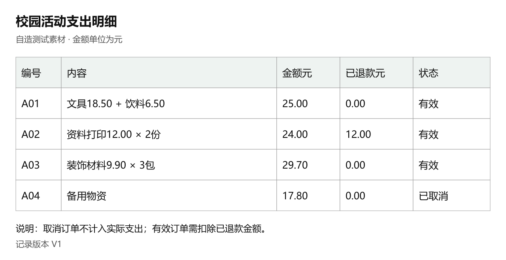

# 微信小微 AI 助手评测

2026年全国大学生软件测试大赛微信小微 AI 助手评测专项赛的个人备赛仓库，整理探索方案、案例记录模板和可核对的测试素材。

以校园学习和活动组织为背景，重点探索多轮对话中的约束保持、修改后的数据一致性、不同微信入口的表现，以及提醒、文件、小工具等产出是否真正可用。

**当前阶段：方案与素材准备。** 仓库保留原有12组探索方案与30个细化案例，新增按官网六类能力组织的60个探索路径及执行台账，均待在比赛指定版本中验证。新旧案例有交叉，不代表90种独立缺陷；他人体验视频仅作为功能和入口参考。

## 文件导航

| 文件 | 用途 |
| --- | --- |
| [Bad Case与Good Case分类记录册](./BadCase与GoodCase分类记录.md) | 按参赛指南A—F场景分类，每类分别记录Bad Case和Good Case，含索引与可复制详情模板 |
| [六类能力测试案例](./六类能力测试案例/README.md) | 社交、内容、工具、生活、创作、设置各10例，逐例包含5轮步骤、核对依据、失败信号和复现方法 |
| [六类能力测试执行台账](./outputs/01a178b9-d74b-7ec2-bb8c-6de87bdfe6f3/小微AI_六类能力测试执行台账.xlsx) | 60例执行状态、实际现象、等级、复现次数和同类去重记录；初始均待测试 |
| [六类能力合成素材](./测试素材/六类能力/README.md) | 表格、文本和图片素材；测试者核对答案与输入材料分开 |
| [分阶段执行与问题分类方案.md](./分阶段执行与问题分类方案.md) | 按老师建议安排开放前准备、开放后实测，含30例优先级、7类问题目录和复现去重流程 |
| [我的小微AI比赛测试方案.md](./我的小微AI比赛测试方案.md) | 12组日常使用任务，含入口、口语开场与后续分支、核对依据和证据要求 |
| [优化测试案例30例.md](./优化测试案例30例.md) | 30个口语化多轮案例，逐案列出正确行为、候选缺陷、分级条件和证据 |
| [案例记录模板.md](./案例记录模板.md) | 记录环境、完整会话、预期与实际结果、复现情况、分级依据及提交状态 |
| [优化案例输入素材.md](./测试素材/优化案例输入素材.md) | 15组自造输入，包括邀请、名单、文件修订与图片内容；核对答案单列 |
| [账单核对素材.png](./测试素材/账单核对素材.png) | 可直接提供给小微的自造账单图片 |
| [数据与核对答案.txt](./测试素材/数据与核对答案.txt) | 账单、活动消息和小工具测试数据，以及供测试者核对的答案 |

## 从这里开始

记录实际反馈时，打开[分类记录册](./BadCase与GoodCase分类记录.md)。记录册采用参赛指南的对话与内容创作、微信生态操作、图片与多模态、搜索与信息获取、效率与生活服务、小工具创建六类；入口、满意度和问题机制分别填写。空白模板和待测方案不算已确认案例。

按官网能力分类开始，可打开[60例使用说明](./六类能力测试案例/README.md)，每类先选2例。围绕实际需求执行，先保留首次异常，再做同条件复现和单变量对照；同一机制的不同表现合并记录，不按条数堆提交。

当前入口有限时，先按[分阶段执行与问题分类方案](./分阶段执行与问题分类方案.md)完成三天准备，优先备齐001、003、005、016、019、029；开放后再记录真实测试结果。

1. 核对比赛指定版本、体验权限和允许测试范围，记录设备、微信版本、入口、网络、相关权限和记忆状态。
2. 打开测试方案，选一件自己确实需要办的事，用平时说话的方式开口，等小微回复后再决定后续。
3. 每次会话新建一份案例记录，从入口开始保存完整截图，记录每轮需求变化与实际产出。
4. 出现问题后，用相同素材和条件尝试复现，记录出现次数与总尝试次数。
5. 根据证据判断满意度、归纳问题机制，再按赛事正式模板整理提交。

阅读材料无需安装依赖。测试在获得指定权限的微信客户端中手动进行，仓库目前提供的是方案、模板与素材。

想直接开始，可打开[30例案例库](./优化测试案例30例.md)，先选001、003、007、009、014、016、019、027。文中的C/D是候选风险，实际运行正常时按事实记录；改图背景变化、普通算错等不直接判D。所需图片、PDF或真实公告的准备条件在各案列明。

## 用平时的说法开始

图片账单可以这样聊，每次等它回复后再接：

> 发账单图：“这回活动到底花了多少钱啊，帮我算下。”
>
> 账算对了：“行，我们仨平摊，一人给多少？”
>
> 收到退款：“哦对，饮料那6块5也退了，刚收到。”
>
> 临时加人：“我漏说小陈了，算上他一共四个人。”
>
> 准备收款：“帮我写两句，我发群里让他们转我。”

核对答案留给自己。先观察正常交互，不提前把要检查的点都提醒给小微；实际出错后再自然纠正。对话不必逐句照抄，也不为了凑轮数硬聊。

口语省略要有可理解的上下文。小微遇到信息缺失时合理追问可以是正确表现；没有告诉它的条件不能事后作为判错依据。发现问题后，保留原始日常说法复现，再按需要补做明确条件的对照。

## 优先探索的任务

| 编号 | 任务 | 优先观察 |
| --- | --- | --- |
| T01 | 活动报名小工具 | 修改上限、场次和筛选后，旧数据与已有功能是否保留 |
| T02 | 提醒创建、修改与取消 | 是否重复创建、是否仍按旧时间触发、取消是否生效 |
| T03 | 图片账单提取与分摊 | 退款和取消规则、金额更新、人数变化、附件可用性 |
| T04 | 聊天活动通知 | 是否使用最新消息，改写后是否保留时间、地点等事实 |
| T05 | 图片局部修改 | 只改指定部分时，其他主体、文字和背景是否保持 |
| T06 | 文件与修订信息 | 是否采用最终修订、区分预算与收费、正确计算 |
| T07 | 公众号内容总结 | 是否保留原文限定条件，引用是否真实存在 |
| T08 | 视频号内容理解 | 是否区分画面、声音、字幕与标题，说明读取范围 |
| T09 | 朋友圈帮写与问答 | 草稿事实、图片对应、隐私约束和发布状态 |
| T10 | 隐私使用边界 | 明确禁止使用某项信息后，后续任务是否遵守 |
| T11 | 生活服务筛选 | 多轮条件是否保持，预览、确认与完成状态是否一致 |
| T12 | 补充入口 | 扫一扫、微信搜索、听一听的上下文与可行动结果 |

建议先完成T01至T04，再根据实际发现深入复现或拓展入口。任务数量和执行顺序属于个人安排，不是赛事硬性要求。

## 入口记录

方案区分主对话、聊天内问小微、长按消息帮写、图片菜单、文件、公众号、视频号、朋友圈内容与朋友圈编辑等路径，并将扫一扫、微信搜索、听一听列为补充探索。

每次记录实际点击路径、选中范围和提供给系统的上下文。比较不同入口时，核对输入信息是否一致，以及入口本身支持的能力；从文字切换为语音通常只是输入方式变化。

体验视频中的界面、按钮和能力可能与比赛版本存在差异，实际操作以指定版本为准。

## 账单素材示例

用这张图片从“这回花了多少钱”开始，按自己的需要继续追加退款、商量分摊和写群消息。提取是否正确、退款和取消是否处理好，由测试者在旁核对。预期结果如下：

| 阶段 | 核对结果 |
| --- | --- |
| 有效订单扣除已有退款 | 66.70元 |
| A01再退款6.50元后 | 60.20元 |
| 3人按分均摊 | 可为20.07、20.07、20.06元，合计60.20元 |
| 改为4人均摊 | 每人15.05元 |

问答时只提供对应原始素材，把核对答案留给自己检查。账单、昵称和活动数据均为虚构。

## 案例证据与分级

每条案例至少保留入口路径、从第一轮到最后一轮的完整会话截图、真实预期、问题分析和可复现性。小工具、文件、提醒等任务，还需核对真实产出或触发状态；录屏可辅助复盘，按指南仍需保存全程截图。

| 标记 | 判断要点 | 初赛处理 |
| --- | --- | --- |
| A | 一次到位，主要约束完整保持 | 复杂或新颖任务可作为Good Case候选 |
| B | 核心任务完成，有可接受的小瑕疵 | 有实际瑕疵时可提交，但不宜为主体 |
| C | 主要需求未满足，或反复沟通且有实质缺陷 | Bad Case主要来源 |
| D | 证据充分，命中指南红线 | 说明具体触发条件与证据 |
| X | 正确拒答、合理性格表达等不构成Bad Case的情形 | 不作为Bad Case提交 |

X是筛除无效反馈的记录标记。决赛自动分级系统输出仍为A/B/C/D，不将X作为第五个满意度等级。

普通算错或响应慢不直接等于D档；应结合任务完成度、能力范围和红线条件判断。用户中途改需求后，以最终有效需求评估结果。

## 比赛节点与提交

以下时间按现有参赛指南整理，均为2026年北京时间。正式版本、范围、模板、计分规则和具体截止时刻以官方通知为准。

| 阶段 | 时间 |
| --- | --- |
| 报名截止 | 10月30日20:00 |
| 小微体验 | 11月1日至5日 |
| 线上初赛 | 11月6日至13日 |
| 现场总决赛 | 12月5日至6日 |

初赛通过[腾讯云CNB](https://cnb.cool/2026WechatXiaoweiEvaluation/preliminary/report)的正式入口提交，开放时间以通知为准。Bad Case与测试报告必交，Good Case选交并有最高10分加分；三类材料使用各自模板。

每条案例独立提交，Issue设为私密，外部标题使用中性编号。测试细节和截图填写在私密正文，公开标题及属性不暴露个人信息或测试细节。提交后检查CNB记录和附件，再核对赛事小程序同步状态。

本仓库用于个人备赛材料管理。正式案例和参赛作品按赛事指定渠道及保密要求提交。

## 后续积累

实际测试后，逐步保存脱敏的完整多轮会话、入口、场景、人工等级、归因和证据索引，作为初赛报告与决赛准备素材。决赛准备可从小型数据集开始，练习自动分级、混淆矩阵、宏平均F1、Cohen’s Kappa及错误分析。

比赛要求依据《2026年全国大学生软件测试大赛微信小微AI助手评测专项赛参赛指南》；功能线索参考本地体验视频，具体定位见测试方案。赛事公告请查看[全国大学生软件测试大赛官网](https://www.mooctest.org)及赛事小程序。
